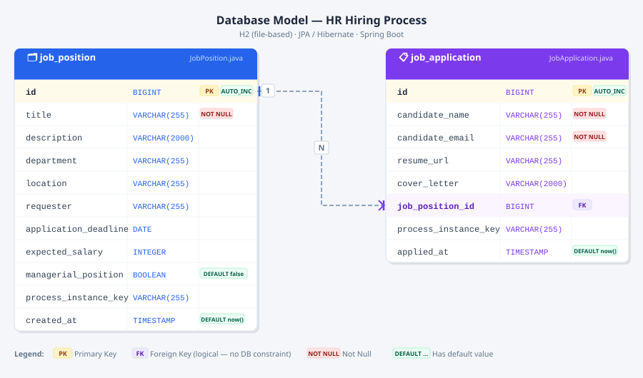

# HR Hiring Process App

Spring Boot application with Camunda 8 integration for the HR hiring process. This project serves as a training for implementing Camunda 8 processes.

## Prerequisites

- Java 21
- Maven 3.9+
- Camunda 8 (Zeebe, Keycloak, etc.)

## Build & Run

```bash
# Build
mvn clean package

# Run
mvn spring-boot:run
```

The application starts by default on **port 8089**. This can be changed in the application.properties.

## Project Structure

```
docs/
└── db-model.svg                               # Entity-Relationship diagram (generated)
src/main/
├── java/cz/kyndryl/camunda/
│   ├── Application.java                       # Spring Boot entry point
│   ├── config/
│   │   ├── ArtemisConfig.java                 # Embedded Artemis JMS configuration
│   │   ├── ArtemisMonitorController.java      # REST endpoints for Artemis queue inspection
│   │   ├── CamundaConfig.java                 # Camunda client config & BPMN/form deployment
│   │   └── EmbeddedSmtpConfig.java            # Embedded GreenMail SMTP server
│   ├── controller/
│   │   ├── EmailInboxController.java          # GET /api/emails — reads captured GreenMail messages
│   │   ├── JobApplicationController.java      # REST API for job applications
│   │   ├── JobPositionController.java         # REST API for job positions
│   │   ├── TaskPageController.java            # Serves user task HTML pages
│   │   └── UserTaskController.java            # GET/POST /api/tasks — variables & completion
│   ├── entity/
│   │   ├── JobApplication.java                # JPA entity for job applications
│   │   └── JobPosition.java                   # JPA entity for job positions
│   ├── repository/
│   │   ├── JobApplicationRepository.java      # Spring Data JPA for job applications
│   │   └── JobPositionRepository.java         # Spring Data JPA for job positions
│   ├── service/
│   │   ├── EmailService.java                  # Generic email sending service (no Camunda dependency)
│   │   └── MessageService.java                # JMS message sending service
│   └── worker/
└── resources/
    ├── application.properties                 # Application configuration
    ├── data.sql                               # Initial seed data (runs on startup)
    ├── forms/
    ├── processes/
    └── static/
        ├── index.html                         # HR Hiring Portal (public)
        ├── email-inbox.html                   # Email inbox UI (GreenMail viewer)
        ├── artemis.html                       # Artemis Monitor UI (queue/topic browser)
        └── tasks/
            ├── common.css                     # Shared styles for task pages
            ├── common.js                      # Shared JS (task variable loading, completion)
            ├── evaluate-shortlist.html        # Task: Evaluate & Shortlist Candidates
            ├── final-candidate-selection.html # Task: Final Candidate Selection
            ├── interview-candidate.html       # Task: Interview Candidate
            ├── job-position-specification.html # Task: Job Position Specification
            └── job-position-validation.html   # Task: Job Position Validation
```

## Embedded Services

All three infrastructure services run embedded inside the application — no external servers needed (besides Camunda 8 itself).

### H2 Database

File-based H2 database that persists data across application restarts.

| Property          | Value                                        |
|-------------------|----------------------------------------------|
| JDBC URL          | `jdbc:h2:file:./data/hr-hiring-db`           |
| Username          | `sa`                                         |
| Password          | *(empty)*                                    |
| DDL strategy      | `update` (tables created from JPA entities)  |
| Data directory    | `./data/hr-hiring-db.*`                      |

#### H2 Console

Available at: **http://localhost:8089/h2-console**

To connect, enter these values in the console login form:

| Field         | Value                                                              |
|---------------|--------------------------------------------------------------------|
| Driver Class  | `org.h2.Driver`                                                    |
| JDBC URL      | `jdbc:h2:file:./data/hr-hiring-db`                                 |
| User Name     | `sa`                                                               |
| Password      | *(leave empty)*                                                    |

### Artemis MQ Broker

Embedded Apache Artemis JMS broker with persistent message storage.

| Property          | Value              |
|-------------------|--------------------|
| Mode              | Embedded           |
| Persistence       | Enabled            |
| Data directory    | `./data/artemis`   |

Use the `MessageService` to send messages:

```java
@Autowired
private MessageService messageService;

messageService.sendMessage("my-queue-name", "message payload");
```

Queues are created automatically on the first `sendMessage` (point-to-point, ANYCAST), no pre-configuration needed. `publishToTopic(topic, message)` publishes to the `hiring.portal.events` topic; a durable subscription queue `hiring.portal.events.archive` is declared at startup so published messages stay visible in the Artemis Monitor.

#### Artemis Monitor UI

All active queues and topics can be inspected in the built-in monitor at **http://localhost:8089/artemis.html**.

The monitor is also accessible via the **🗂 Artemis Monitor** link in the top-right corner of the Hiring Portal. It is backed by the `GET /artemis/queues` and `GET /artemis/queues/{name}/messages` endpoints. The sidebar groups entries by type (Queues = ANYCAST, Topics = MULTICAST) and shows a message count badge when there are pending messages. Selecting a queue shows stats (pending, consumers, delivering, total added, acknowledged) and a table of up to 50 pending messages. The page auto-refreshes every 10 seconds.

### SMTP Server (GreenMail)

Embedded GreenMail SMTP server for capturing emails during development. Emails are not delivered externally — they are captured in-memory by GreenMail.

| Property   | Value            |
|------------|------------------|
| Host       | `localhost`      |
| Port       | `3025`           |
| Username   | `test@localhost` |
| Password   | `test`           |

Use the `EmailService` to send emails:

```java
@Autowired
private EmailService emailService;

emailService.sendEmail("recipient@example.com", "Subject", "Body text");
```

#### Email Inbox UI

All captured emails can be viewed in the built-in inbox at **http://localhost:8089/email-inbox.html**.

The inbox is also accessible via the **📬 Email Inbox** link in the top-right corner of the Hiring Portal. It is backed by the `GET /api/emails` endpoint which reads all received messages directly from the GreenMail instance (newest first). Use the **Refresh** button to pick up newly sent emails without reloading the page.

## Camunda 8 Connection

The application connects to a local Camunda 8 Self-Managed instance, adjust the properties accordingly if needed.
Ask your instructor for the connection details if needed.

| Property       | Value                                                                                      |
|----------------|--------------------------------------------------------------------------------------------|
| Mode           | `self-managed`                                                                             |
| Auth method    | `oidc`                                                                                     |
| Client ID      | `orchestration`                                                                            |
| Token URL      | `http://localhost:18080/auth/realms/camunda-platform/protocol/openid-connect/token`        |
| gRPC address   | `http://localhost:26500`                                                                   |
| REST address   | `http://localhost:8088`                                                                    |
| Tenant ID      | `demo`                                                                                     |

## User Interfaces

### Hiring Portal

**[http://localhost:8089](http://localhost:8089)** — Public-facing page listing open positions with an application submission form.

### Email Inbox

**[http://localhost:8089/email-inbox.html](http://localhost:8089/email-inbox.html)** — View all emails captured by the embedded GreenMail SMTP server. Two-panel layout: email list on the left, full message content on the right.

### Artemis Monitor

**[http://localhost:8089/artemis.html](http://localhost:8089/artemis.html)** — Browse all active Artemis queues and topics. The sidebar groups queues (ANYCAST) and topics (MULTICAST) separately and highlights those with pending messages. Selecting an entry shows queue stats and a table of up to 50 pending messages. Auto-refreshes every 10 seconds.

### Quick links

The Hiring Portal start page ([http://localhost:8089](http://localhost:8089)) has a link panel with everything below, including a **User task key** box that builds the task-screen links for you.

| Screen / tool | Link |
|---|---|
| Hiring Portal (positions + apply form) | [http://localhost:8089](http://localhost:8089) |
| Email Inbox | [http://localhost:8089/email-inbox.html](http://localhost:8089/email-inbox.html) |
| Artemis Monitor | [http://localhost:8089/artemis.html](http://localhost:8089/artemis.html) |
| H2 Console | [http://localhost:8089/h2-console](http://localhost:8089/h2-console) |
| Positions (JSON, shows `jobPositionId`) | [http://localhost:8089/api/positions](http://localhost:8089/api/positions) |
| Applications (JSON) | [http://localhost:8089/api/applications](http://localhost:8089/api/applications) |
| Camunda Operate | [http://localhost:8088/operate](http://localhost:8088/operate) |
| Camunda Tasklist | [http://localhost:8088/tasklist](http://localhost:8088/tasklist) |

### User Task Pages

Each task page takes the Camunda user task key as the last path segment (find the key in Operate or Tasklist, then paste it into the *User task key* box on the start page, or replace `{taskKey}` in the URL). Task data (position details, candidate info, etc.) is loaded automatically from Camunda process variables via `GET /api/tasks/{taskKey}/variables`.

| Task | URL | Key Process Variables |
|---|---|---|
| Job Position Specification | [`/tasks/job-position-specification/{taskKey}`](http://localhost:8089/tasks/job-position-specification/{taskKey}) | *(empty form — user fills in)* |
| Job Position Validation | [`/tasks/job-position-validation/{taskKey}`](http://localhost:8089/tasks/job-position-validation/{taskKey}) | `title`, `description`, `department`, `location`, `requester`, `requesterEmail`, `applicationDeadline`, `expectedSalary`, `managerialPosition` |
| Evaluate & Shortlist Candidates | [`/tasks/evaluate-shortlist/{taskKey}`](http://localhost:8089/tasks/evaluate-shortlist/{taskKey}) | `jobPositionId`, `title`, `department` |
| Interview Candidate | [`/tasks/interview-candidate/{taskKey}`](http://localhost:8089/tasks/interview-candidate/{taskKey}) | `shortlistedCandidate` (object with `candidateName`, `candidateEmail`) |
| Final Candidate Selection | [`/tasks/final-candidate-selection/{taskKey}`](http://localhost:8089/tasks/final-candidate-selection/{taskKey}) | `shortlistedInterviewedCandidates` (array of interviewed candidates with ratings) |

### Management Endpoints

| Endpoint | Purpose |
|---|---|
| [`GET /api/positions`](http://localhost:8089/api/positions) | List all job positions |
| [`GET /api/applications`](http://localhost:8089/api/applications) | List all applications (optional `?positionId=X`) |
| `GET /api/tasks/{taskKey}/variables` | Fetch process variables for a user task |
| `POST /api/tasks/{taskKey}/complete` | Complete a Camunda user task with variables |
| [`GET /api/emails`](http://localhost:8089/api/emails) | List all emails captured by GreenMail (newest first) |
| [`GET /artemis/queues`](http://localhost:8089/artemis/queues) | List Artemis queues and message counts |
| `GET /artemis/queues/{name}/messages` | Browse messages in a queue |
| [http://localhost:8089/email-inbox.html](http://localhost:8089/email-inbox.html) | Email inbox UI |
| [http://localhost:8089/artemis.html](http://localhost:8089/artemis.html) | Artemis Monitor UI |
| [http://localhost:8089/h2-console](http://localhost:8089/h2-console) | H2 Database web console |

## User Task Interface Contracts

Each user task page communicates with the process through a well-defined set of variables. The tables below document exactly what each screen reads from the process on load (**Process → UI**) and what it writes back to the process on completion (**UI → Process**).

All task pages are served at `/tasks/{page}/{taskKey}` and use `GET /api/tasks/{taskKey}/variables` to read variables and `POST /api/tasks/{taskKey}/complete` to submit them.

---

### Job Position Specification

**URL:** `/tasks/job-position-specification/{taskKey}`
**Role:** Hiring manager fills in the new position details. No pre-filled data — blank form.

#### Process → UI

*No process variables consumed — the form is always empty on load.*

#### UI → Process

| Variable | Type | Required | Notes |
|---|---|---|---|
| `title` | `string` | ✅ | Position title |
| `description` | `string` | ✅ | Role description and requirements |
| `department` | `string` | ✅ | Department name |
| `location` | `string` | ✅ | Work location |
| `requester` | `string` | ✅ | Name of the person requesting the position |
| `requesterEmail` | `string` | ✅ | Email of the requester; used for notifications (rejection, position filled, nobody hired) |
| `applicationDeadline` | `string` | ✅ | ISO date (`yyyy-MM-dd`); must be a future date |
| `expectedSalary` | `integer` | ✅ | Expected monthly salary (min 0) |
| `managerialPosition` | `boolean` | ✅ | `true` if the role is managerial |

---

### Job Position Validation

**URL:** `/tasks/job-position-validation/{taskKey}`
**Role:** HR reviews the submitted position and approves or rejects it.

#### Process → UI

All fields below are **Camunda process variables** in scope for this task — they were written into the process when the previous task (Job Position Specification) was completed. The UI reads them via `GET /api/tasks/{taskKey}/variables` (the Zeebe task variables endpoint), with no additional application REST calls needed.

| Variable | Type | Notes |
|---|---|---|
| `title` | `string` | Displayed read-only |
| `description` | `string` | Displayed read-only |
| `department` | `string` | Displayed read-only |
| `location` | `string` | Displayed read-only |
| `requester` | `string` | Displayed read-only |
| `requesterEmail` | `string` | Displayed read-only |
| `applicationDeadline` | `string` | Displayed read-only |
| `expectedSalary` | `number` | Displayed read-only |
| `managerialPosition` | `boolean` | Displayed as `Yes` / `No` |

#### UI → Process

| Variable | Type | Required | Notes |
|---|---|---|---|
| `hrCheckResult` | `string` | ✅ | `"OK"` (approved) or `"NOK"` (rejected) |
| `validationComment` | `string` \| `null` | ❌ | Optional reviewer comment |

---

### Job Position Approval

**Form file:** `src/main/resources/forms/job-position-approval.form`
**Form ID:** `jobPositionApprovalForm_v1`
**Role:** Manager reviews the HR-validated position and gives the final approval decision.

> ⚠️ **This is a Camunda-native form**, not a custom HTML page. It is defined in JSON using the Camunda Forms schema, deployed to the engine alongside the BPMN, and rendered automatically by Camunda Tasklist (or any compatible client). Variable binding is handled by the form renderer based on each field's `key` — no custom JavaScript is involved.

> This task is **conditional** — it is only reached when the "Further Approval Required?" gateway evaluates to `Yes` (e.g. for managerial positions). If no further approval is needed the process skips directly to saving the position.

#### Process → Form

All fields are displayed **read-only**. They are standard Camunda process variables in scope, written by the earlier Job Position Specification task.

| Variable | Type | Notes |
|---|---|---|
| `title` | `string` | Displayed read-only |
| `department` | `string` | Displayed read-only |
| `location` | `string` | Displayed read-only |
| `applicationDeadline` | `string` | Displayed read-only |
| `requester` | `string` | Displayed read-only |
| `requesterEmail` | `string` | Displayed read-only |
| `description` | `string` | Displayed read-only (textarea) |
| `expectedSalary` | `number` | Displayed read-only |
| `managerialPosition` | `boolean` | Displayed as a disabled checkbox |

#### Form → Process

| Variable | Type | Required | Notes |
|---|---|---|---|
| `approved` | `string` | ✅ | `"true"` (Approve) or `"false"` (Reject) — note: **string**, not boolean; radio button values in Camunda Forms are always strings |
| `approvalComment` | `string` \| `null` | ❌ | Optional comment; description hints to provide a reason especially when rejecting |

---

### Evaluate & Shortlist Candidates

**URL:** `/tasks/evaluate-shortlist/{taskKey}`
**Role:** HR selects which applicants advance to interviews.

#### Process → UI

This task runs inside the *Candidate Selection* subprocess, which only receives `jobPositionId` in its variable scope — the full position details (title, department, etc.) are not propagated into the subprocess. The UI therefore makes two additional calls to the **application's own Spring Boot REST API** to retrieve the display data it needs:

| Variable | Type | Source | Notes |
|---|---|---|---|
| `jobPositionId` | `integer` | Camunda process variable (`GET /api/tasks/{taskKey}/variables`) | Primary key used for all subsequent lookups |
| `title` | `string` | Application REST API (`GET /api/positions/{jobPositionId}`) | Not a process variable in this scope; fetched from H2 database |
| `department` | `string` | Application REST API (`GET /api/positions/{jobPositionId}`) | Not a process variable in this scope; fetched from H2 database |
| *(candidate list)* | `array` | Application REST API (`GET /api/applications?positionId={jobPositionId}`) | All submitted applications for the position; fetched from H2 database |

#### UI → Process

| Variable | Type | Required | Notes |
|---|---|---|---|
| `shortlistedCandidates` | `array<object>` | ✅ | At least one candidate must be selected |
| `shortlistedCandidates[].applicationId` | `integer` | ✅ | ID from the `job_application` table |
| `shortlistedCandidates[].candidateName` | `string` | ✅ | |
| `shortlistedCandidates[].candidateEmail` | `string` | ✅ | |

---

### Interview Candidate

**URL:** `/tasks/interview-candidate/{taskKey}`
**Role:** Interviewer records the outcome of a single interview.

> This task runs inside a **multi-instance subprocess** — one task instance is created per shortlisted candidate. The BPMN maps `shortlistedCandidates[i]` → `shortlistedCandidate` as the input element for each instance.

#### Process → UI

| Variable | Type | Notes |
|---|---|---|
| `shortlistedCandidate` | `object` | Per-instance variable injected by the multi-instance loop |
| `shortlistedCandidate.candidateName` | `string` | Displayed in the Candidate Information panel |
| `shortlistedCandidate.candidateEmail` | `string` | Displayed in the Candidate Information panel |
| `shortlistedCandidate.applicationId` | `integer` | Passed through to the output |

#### UI → Process

The page returns **one** object, `interviewedCandidate`. The multi-instance subprocess uses it as the **output element** (`=interviewedCandidate`) and collects the objects of all instances into the `shortlistedInterviewedCandidates` output collection.

| Variable | Type | Required | Notes |
|---|---|---|---|
| `interviewedCandidate` | `object` | ✅ | Single object per task instance (not a list); BPMN collects all of them into the `shortlistedInterviewedCandidates` array |
| `interviewedCandidate.candidateName` | `string` | ✅ | Copied from input |
| `interviewedCandidate.candidateEmail` | `string` | ✅ | Copied from input |
| `interviewedCandidate.applicationId` | `integer` \| `null` | ✅ | Copied from input |
| `interviewedCandidate.interviewRating` | `integer` | ✅ | 1 (Poor) – 5 (Excellent) |
| `interviewedCandidate.technicalSkills` | `string` \| `null` | ❌ | Free-text technical assessment |
| `interviewedCandidate.communicationSkills` | `string` \| `null` | ❌ | Free-text communication assessment |
| `interviewedCandidate.interviewNotes` | `string` \| `null` | ❌ | Any other observations |
| `interviewedCandidate.recommendation` | `string` | ✅ | `STRONG_HIRE`, `HIRE`, `NO_HIRE`, or `STRONG_NO_HIRE` |

---

### Final Candidate Selection

**URL:** `/tasks/final-candidate-selection/{taskKey}`
**Role:** Hiring manager reviews all interview results and either selects one candidate to hire or decides no hire.

#### Process → UI

Like Evaluate & Shortlist, this task runs inside the *Candidate Selection* subprocess. `title` and `department` are not process variables here — they are looked up via the application REST API using `jobPositionId`. `shortlistedInterviewedCandidates` is a genuine Camunda process variable, assembled by the BPMN output collection after all Interview Candidate instances complete.

| Variable | Type | Source | Notes |
|---|---|---|---|
| `jobPositionId` | `integer` | Camunda process variable (`GET /api/tasks/{taskKey}/variables`) | Used for the position lookup |
| `title` | `string` | Application REST API (`GET /api/positions/{jobPositionId}`) | Not a process variable in this scope; fetched from H2 database |
| `department` | `string` | Application REST API (`GET /api/positions/{jobPositionId}`) | Not a process variable in this scope; fetched from H2 database |
| `shortlistedInterviewedCandidates` | `array<object>` | Camunda process variable (`GET /api/tasks/{taskKey}/variables`) | Collected by BPMN after all interview instances complete; see Interview Candidate output for object shape |

#### UI → Process — Hire path

| Variable | Type | Notes |
|---|---|---|
| `candidateChosen` | `boolean` | `true` |
| `hiredCandidateName` | `string` | Name of the selected candidate |
| `hiredCandidateEmail` | `string` | Email of the selected candidate |

#### UI → Process — No Hire path

| Variable | Type | Notes |
|---|---|---|
| `candidateChosen` | `boolean` | `false` |
| `hiredCandidateName` | `null` | |
| `hiredCandidateEmail` | `null` | |

---

## Available Services for Job Workers

Developers should inject these services into their `@JobWorker` methods:

| Service            | Method                                        | Purpose                    |
|--------------------|-----------------------------------------------|----------------------------|
| `EmailService`     | `sendEmail(to, subject, body)`                | Send a plain email via SMTP. No Camunda dependency — caller resolves recipient, subject and body. |
| `MessageService`   | `sendMessage(queueName, message)`             | Send a message to a JMS queue (created automatically) |
| `MessageService`   | `publishToTopic(topicName, message)`          | Publish a message to a JMS topic |
| Spring Data JPA    | Create `@Entity` + `JpaRepository` interfaces | Persist and query data in H2  |

## Data Persistence

### Database Model



The application has two JPA entities persisted in H2. `job_application.job_position_id` references `job_position.id` — the relationship is logical only (no database-level foreign key constraint, as JPA does not generate one without an explicit `@ManyToOne` / `@JoinColumn`).

Both the H2 database and Artemis MQ store data in the `./data/` directory at the project root. This directory is created automatically on first run.

To reset all data, stop the application and delete the `./data/` directory:

```bash
rm -rf ./data
```
